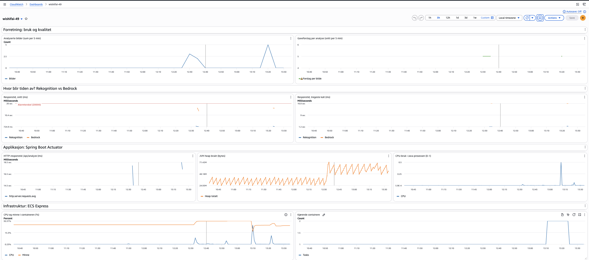

# PGR301 Eksamen 2026 - Besvarelse

## Oppgave 1A

Dockerfilen har to steg (multi-stage build): Et steg som bygger applikasjonen, og et som kjører den. Første steget bruker et Maven-image med full JDK, for å bygge JAR-filen. Det andre steget starter på nytt fra et rent JRE-image og kopierer kun inn JAR-filen, så Maven, JDK og kildekoden ikke havner i det endelige imaget. Resultatet er et mindre og sikrere image, fordi det bare inneholder det som trengs for å kjøre appen. 

Bygg og start containeren:

    docker build -t wishifai .
    docker run --rm -p 9999:8080 \
      -e AWS_ACCESS_KEY_ID=<din-nøkkel> \
      -e AWS_SECRET_ACCESS_KEY=<din-hemmelighet> \
      -e S3_BUCKET=wishifai-49-images \
      wishifai

Test:

    curl http://localhost:9999/api/health
    curl -F "image=@samples/sample_image.png" http://localhost:9999/api/analyze

## Oppgave 1B

Workflow: `.github/workflows/pipeline.yml`

Grønn kjøring: https://github.com/lilliantraan/pgr301-eksamen-2026/actions/runs/42622640901

ECR-repository: `wishifai-49`

Tagging-strategi: Tagger hvert image med både commit-SHA og "latest". "Latest" flyttes ved hver push, så den ikke alene sier hvilken kode som faktisk kjører. Med commit-SHA, kan jeg spore et image tilbake til nøyaktig den commiten i GitHub, og gå tilbake ved å deploye en eldre tag. Ulempen, er at det blir mange images i ECR over tid, så i et ekte prosjekt ville jeg satt opp automatisk sletting av gamle images.

## Oppgave 2A

Terraform-koden ligger i infra/.

Offentlig URL: https://wi-ecb34eb33cfb49f3b9d72039de9b66f0.ecs.eu-west-1.on.aws

Test:

    curl https://wi-ecb34eb33cfb49f3b9d72039de9b66f0.ecs.eu-west-1.on.aws/api/health
    curl -F "image=@samples/sample_image.png" https://wi-ecb34eb33cfb49f3b9d72039de9b66f0.ecs.eu-west-1.on.aws/api/analyze

## Oppgave 2B

State lagres i bucketen pgr301-terraform-state med nøkkelen wishifai/49/terraform.tfstate.

## Oppgave 2C

Grønn kjøring:  https://github.com/lilliantraan/pgr301-eksamen-2026/actions/runs/42718022909

Terraform-jobben kjører i rekkefølgen `fmt-check`, `init` og `apply`.fmt-check` og `validate` stopper pipelinen tidlig, dersom koden er feil formatert eller ugyldig, før noe endres i AWS. AWS-nøklene hentes fra GitHub secrets, på lik måte som i oppgave 1B. 

Jeg har satt `wait_for_steady_state = true`, slik at Terraform venter til den nye versjonen faktisk er oppe og fungerer. Uten dette, ville piplinen vært grønn selv om den nye containeren kræsjet. ECS express ruller ut med en ny canary-deploy, så den gamle versjonen fortsetter å svare brukere, til den nye har bestått helsesjekkene. Jeg så dette under utrullingen, der den gamle og nye versjonen kjørte samtidig. `concurrency` sørger for at to push rett etter hverandre ikke kjører `apply` mot den samme infrastrukturen samtidig.

En svakhet, er at `apply` kjører med `-auto-approve`, uten at noen ser over endringene først. I et team, ville jeg latt `terraform plan` kjøre pull requests, slik at endringene blir vurdert før de merges og eventuelt krevd manuell godkjenning før produksjon. 

## Oppgave 3A

| Metrikk | Type | Statistikk | Hva den viser |
|---|---|---|---|
| `wishifai.rekognition.duration` | Timer | Average, Maximum | Tid brukt på Rekognition-kallet |
| `wishifai.bedrock.duration` | Timer | Average, Maximum | Tid brukt på Bedrock-kallet |
| `wishifai.images.analyzed` | Counter | Sum | Antall bilder analysert (business) |
| `wishifai.suggestions.per.analysis` | DistributionSummary | Sum / antall | Gaveforslag per bilde, altså svarkvalitet |

Grunderen opplevde at tjenesten responderte treigt, så første målet var å finne ut av hvor tiden blir av. Jeg la til en egen klasse, WishlistMetrics, som samler alle metrikkene på et sted istedenfor å spre dem utover forretningslogikken. Alle metrikkene publiseres til CloudWatch under namespace wishifai-49.

Timers for Rekognition og Bedrock (wishifai.rekognition.duration og wishifai.bedrock.duration):
En request gjør tre kall etter hverandre: S3, Rekognition og Bedrock. Dersom jeg bare målte hele requesten, ville jeg visst at den er treg, men ikke hvorfor. Ved å måle Rekognition-kallet og Bedrock-kallet hver for seg, så ser jeg hvilket steg som er "the bottleneck". Da jeg testet lokalt, tok Rekognition i snitt 0,9 sekunder og Bedrock 14,2 sekunder, så det er tydelig at Bedrock bruker mest tid. Jeg brukte en Timer direkte istedenfor @Times, fordi @Timed krever ekstra oppsett (AOP), som prosjektet ikke har. En Timer registrrer antall, sum og maks. I tillegg, CloudWatch regner ut snittet fra disse, slik at jeg ser både vanlig og verst mulig responstid. 

Analyserte bilder (wishifai.images.analyzed, Counter):
Dette er en business-metrikk. Den viser hvor mye tjenesten faktisk brukes, ikke den tekniske tilstanden. Den øker bare når en analyse er fullført, så den teller reell verdi til brukerne. En Counter går bare oppover, så Sum per periode er riktig statistikk for den.

Gaveforslag per analyse (wishifai.suggestions.per.analysis, DistributionSummary):
Dette er min andre business-metrikk, og i motsetning til timerne, måler den innholdet i svarene, ikke responstiden. Bedrock er ikke-deterministisk , og kan gi dårlige svar uten at det oppstår noen feil: forespørselen returnerer fortsatt 200, men med færre eller ingen forslag. For eksempel, hvis svaret fra modellen ikke kan tolkes. Det som ville avslørt dette, er et fall i gjennomsnittlig antall forslag, selv om ingen feil blir logget. 

## Oppgave 3B

Dashboard: wishifai-49 (CloudWatch, eu-west-1). Lenken skrives ut med `terraform -chdir=infra output dashboard_url`.

Dashboard og alarm er definert som kode i `infra/dashboard.tf`og `infra/alarm.tf`. Dashboard er delt i fire rader, slik at det er lettere å se hvilken type metrikk hver graf viser:

- Forretning: Antall analyserte bilder, og antall gaveforslag per bilde. 

Antall bilder er en Counter, så Sum er brukes per periode. For forslag per bilde, deler jeg totalt antall forslag på totalt antall bilder. Grunnen, er fordi et snitt av snitt blir misvisende når perioende har ulikt antall bilder.

- Hvor tiden blir av: Snitt og maks responstid for Rekognition og Bedrock
Grafen viser tydelig at Bedrock (ca. 15 sek) står for nesten all ventetiden, mens Rekognition tar under ett sekund. I tillegg, grafen viser alarmterskelen som en rød linje.

- Applikasjon (Spring Boot Actuator): HTTP-responstid for /api/analyze/, JVM heap og CPU-bruk i Java-prosessen.
HTTP-tiden er cirka summen av Rekognition og Bedrock, som bekrefter målingene. For HTTP og JVM, lar jeg CloudWatch søke opp metrikkene med SEARCH, fordi Actuator lager en egen metrikk for hver kombinasjon av URL, statuskode og minneområde.

- Infrastruktur (ECS Express): CPU og minnebruk i containeren, og antall kjørende containere. 

Alarmen wishifai-49-bedrock-slow varsler når Bedrock er treig, fordi det er nettopp treigheten grunderen var bekymret for og målingene viser at Bedrock er "the bottleneck". Den er satt opp sik:

- Metrikk: gjennomsnittlig responstid for Bedrock-callet. 
- Terskel: 20 000 ms. Normal responstid er rundt 15 sek, så alarmen går når Bedrock er merkbart tregere enn normalt. Terskelen er en variabel, som gjør den lett å justere. 
- Brudd: 3 av 5 perioder, slik at et enkelt tregt kall ikke utløser alarmen.
- Periode: 60 sek, det samme som applikasjonen sender metrikker med. 

Manglende data regnes ikke som brudd. Dersom det ikke kommer inn data, utløses ikke alarmen. Ingen trafikk betyr vell at ingen bruker tjenesten, ikke at den er treg. Varselet sendes på e-post via SNS, også når alarmen går tilbake til OK. E-postadressen ligger som en GitHub Secret og sendes inn som TF_VAR_alarm_email, slik at den ikke havner i et offentlig repo. 

Alarmen fanger ikke opp dårlige svar fra modellen:
- Hvis Bedrock svarer raskt, men med upassende eller mindre gave gaveforslag, så går den ikke. Det er et eksempel på at overvåkning av AI krever mer enn responstid, som jeg kommer tilbake til i oppg. 4.

## Oppgave 4

Generativ AI forander hva det vil si at en applikasjon «fungerer». Wishifai kan være fullt operativ, med raske responstider og feilfrie svar (HTTP-statuskode 200) og likevel f.eks. foreslå en kjøkkenkniv til et barnerom. DevOps-praksiser er utformet for å avdekke tekniske feil. Derfor, må de også utvides til å omfatte kvaliteten på det modellen svarer. 

Testing: Vanlige tester sammenligner resultatet med en forventet verdi, men ettersom Bedrock er ikke-deterministisk, så kan det samme bildet gi forskjellige forslag hver gang. Av den grunn, må tester heller kontrollere egenskaper ved svaret. Et sett bestående av testbilder, med f.eks. «ingen skarpe gjenstander for barn», kan kjøres i en pipeline hver gang instruksen (prompten) eller modellen endres. Dersom en slik evaluering feiler, så bør endringen stoppes, akkurat som når en unit test feiler. Dette henger i tråd med prinsippet fra DevOps Handbook, om å bygge kvalitet inn ved kilden.  «LLM-as-judge» gjør det mulig å vurdere langt flere svar, men en LLM som vurderer en annen LLM kan ta feil. Den bør derfor brukes sammen med menneskelig gjennomgang, og ikke erstatte den. 

Kontinuerlig leveranse: I Wishifai er det mer enn kode som deployes. Prompten ligger i koden, men modellen velges ved hjelp av en ID, en endring kan dermed forandre hvordan applikasjonen svarer. Uavhengig at det foretas en eneste commit. Dette svekker sporbarheten, som jeg argumenterte for i oppg 1B, der hvert image tagges med commit-SHA. Prompts bør versjoneres i Git, og det bør alltid være en fast modellversjon. Slik at alle endringer går gjennom pipeline, og man kan gå tilbake til en tidligere versjon. Større endringer, som en ny modell, kan lanseres gradvis med canary eller feature flags.

Overvåking: CloudWatch-alarmen min varsler når Bedrock er treig, men den ville ikke ha reagert på upassende gaver, ettersom svaret kommer raskt og requesten går igjennom. Metrikken min for antall forslag per bilde fanger opp visse kvalitetsproblemer, f.eks. hvis modellen plutselig slutter å gi forslag, men den oppdager ikke upassende innhold. Overvåking av AI krever andre signaler, som tokenforbruk og  kostnad, hvor ofte modellen nekter å svare brukerrapporter som telles som en metrikk og jevnlige stikkprøver. 

Risiko og ansvar: Hvor langt disse praksisene bør gå, avhenger av konsekvensene av feil. For en gavetjeneste, er et dårlig forslag sjelden alvorlig, selv om det kan svekke tilliten til tjenesten. Derfor bør automatiserte evalueringer og brukerrapporter være nok, og  noen problemer kan oppdages i produksjon. For en bank, kan et feil koste kunden penger. Der bør prompt- og modellendringer kreve menneskelig godkjenning. Testene må bestås, før noe går i produksjon og et menneske bør sjekke anbefalingene før de når kunden. Hver ekstra gate gjør flyten treigere, og rask flyt er et av hovedmålene i DevOps, så antall gates bør stå i forhold til risikoen. 

Konklusjonen er at ansvarlig bruk av KI handler om å teste, levere og overvåke mer enn om tjenesten kjører. Man må likevel sjekke om svarene faktisk er gode nok, og stille strengere krav dersom mer står på spill.
